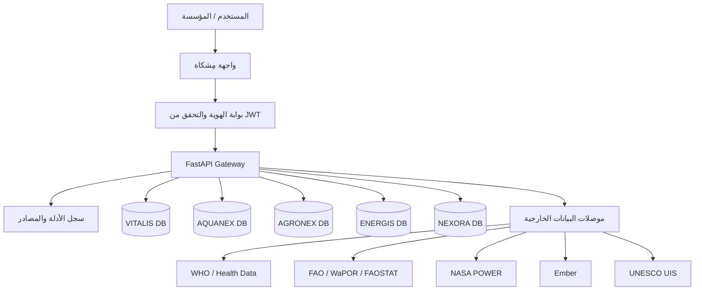

# المعمارية المرجعية لمنصة مِشكاة

## 1. المبدأ المعماري

مِشكاة منتج موحد على مستوى الهوية وتجربة المستخدم والمراقبة، لكنه ليس مستودع بيانات واحداً. النطاقات الخمسة مستقلة في قواعد البيانات وسياسات الصلاحيات والملكية.

- Shared Platform: بوابة الويب، الهوية، التنسيق، سجل الأدلة، مراقبة التشغيل، سجل النماذج، واجهات التكامل.
- VITALIS: نطاق صحي مستقل.
- AQUANEX: نطاق مياه وبنية تحتية مستقل.
- AGRONEX: نطاق زراعي وغذائي مستقل.
- ENERGIS: نطاق طاقة مستقل.
- NEXORA: نطاق تعلم ومعرفة مستقل.

## 2. تدفق الطلب

1. المستخدم يدخل عبر موفر هوية معتمد.
2. تصدر الهوية رمزاً موثقاً، ويتحقق الخادم من التوقيع والمصدر والجمهور ووقت الانتهاء.
3. يحدد المستخدم مساحة العمل المطلوبة.
4. يوجه API الطلب إلى قاعدة المجال فقط.
5. داخل معاملة قاعدة البيانات يضبط الخادم `mishkat.user_id` من هوية موثقة، وليس من قيمة يرسلها العميل.
6. تطبق PostgreSQL سياسات RLS على `owner_id`.
7. تُسجل العملية اللازمة في سجل التدقيق مع معرف المصدر والوقت.

## 3. حدود الثقة

- لا يحصل المتصفح على كلمات مرور قواعد البيانات أو مفاتيح الإدارة.
- لا توجد منافذ PostgreSQL منشورة إلى الإنترنت في Compose.
- حساب `mishkat_app` ليس Superuser ولا يملك BYPASSRLS.
- المفاتيح الأجنبية بين الجداول المملوكة لمستخدمين مركبة على `(owner_id, id)` لمنع ربط سجل بمورد تابع لمالك آخر.
- لا تنتقل البيانات الحساسة بين قواعد المجالات تلقائياً.
- مشاركة البيانات بين مجالين تتطلب واجهة API محددة، وغرضاً واضحاً، وصلاحية، وموافقة عند انطباقها، وأثر تدقيق.
- قواعد البيانات الخمس في Compose منفصلة فعلياً كخدمات وحجوم تخزين. هذا نموذج محلي؛ الإنتاج ينبغي أن يستخدم مشاريع/عناقيد منفصلة وسياسات نسخ احتياطي ومفاتيح مستقلة.

## 4. مخطط منطقي

## 5. لماذا لا نستخدم قاعدة واحدة؟

القطاعات تختلف في طبيعة الحساسية، والاحتفاظ، والمعايير، والتراخيص، وعلاقات المستخدمين. فصل القواعد يقلل أثر الاختراق أو الخطأ التشغيلي، ويتيح سياسات احتفاظ ونسخ احتياطي وأذونات مستقلة. لا يغني فصل قواعد البيانات عن فحص هوية المستخدم وصحة RLS وامتيازات التطبيق.

## 6. واجهات التكامل بين النطاقات

أي تحليل متعدد القطاعات ينبغي أن يبدأ ببيانات مجمعة أو مجهولة الهوية بقدر الإمكان. أمثلة مسموح تصميمها لاحقاً:
- علاقة استهلاك المياه بالطاقة في محطة ضخ باستخدام بيانات تشغيل مصرح بها.
- علاقة مياه الري بالطقس والإنتاج الزراعي في مزرعة شريكة.
- تقارير أثر وطنية تجمع مؤشرات منشورة مجمعة لا سجلات أفراد.

لا يُسمح بتوصيل سجل مريض بملف متعلم أو ربط مستخدم ببيانات حساسة من قطاع آخر دون أساس قانوني واضح وموافقة لازمة.
